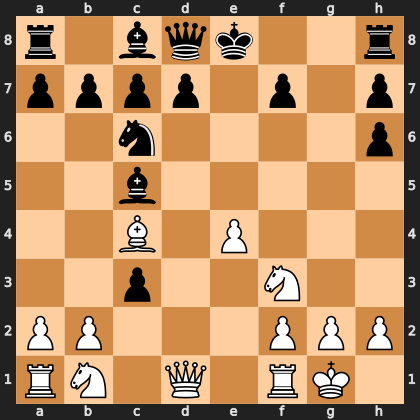

# Puzzle p6fc723d749

<!-- puzzle-id: p6fc723d749 | frame: original | fen: r1bqk2r/pppp1p1p/2n4p/2b5/2B1P3/2p2N2/PP3PPP/RN1Q1RK1 w kq - 0 8 | type: missed_tactic -->

**White to move.** Find the best move.



```
    a b c d e f g h
  8 r . b q k . . r 8
  7 p p p p . p . p 7
  6 . . n . . . . p 6
  5 . . b . . . . . 5
  4 . . B . P . . . 4
  3 . . p . . N . . 3
  2 P P . . . P P P 2
  1 R N . Q . R K . 1
    a b c d e f g h
```

Board is drawn from White's side. Uppercase is White, lowercase is Black.

FEN: `r1bqk2r/pppp1p1p/2n4p/2b5/2B1P3/2p2N2/PP3PPP/RN1Q1RK1 w kq - 0 8`

Status: unattempted | attempts: 0

<details><summary>Answer</summary>

Best move: `Nxc3` (b1c3)

You played: `b2c3`

Eval before: +1.33
Win probability lost: 19.0
Refute depth: 5

Source: https://www.chess.com/game/daily/1047646506, move 8

</details>
