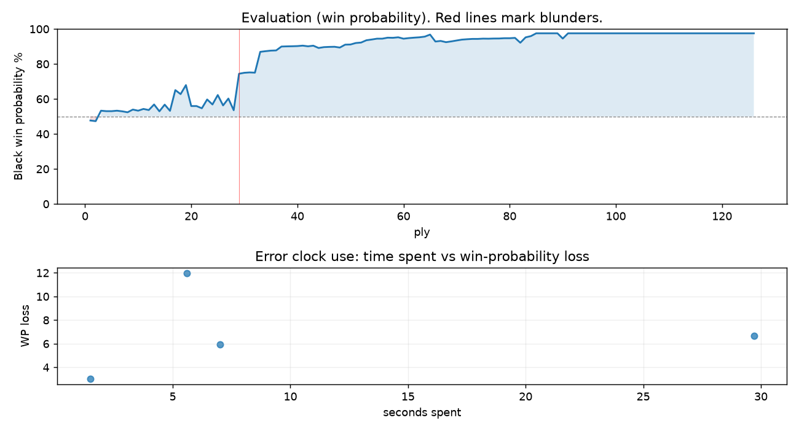

# (free, so lmk) Game analysis: DanielKetterer vs Mirrorwahl

Date: 2026.10.12  |  Time control: rapid (1800)  |  You played: black
Game ID: 2a31d647-c692-11f1-b809-a9c32901000f
Analysis: depth=24 multipv=3 findability=honest floor=6 stable_run=3 threads=1 hash_mb=256 deterministic=True engine_id=Stockfish_18 generated=2026-10-13T15:01:17Z
Game end time UTC: 2026-10-12T23:32:51+00:00
Game: https://www.chess.com/game/live/185236373120

## Summary

- Lichess accuracy: you 95.5%, opponent 90.0%
- Opening: B10 Caro-Kann Defense: Hillbilly Attack (theory followed through ply 3)
- First deviation from theory: ply 4, You played 2... d5
- Your moves: 22 best, 31 excellent, 6 good, 2 inaccuracy, 2 mistake, 0 blunder

METRICS:

Best: The played move exactly matches Stockfish's top move

Excellent: A non-best move that loses 2 WP points or less.

Good: WP loss is over 2, but under 5 points; also used for losses under 20 when the position remains already decided.

Inaccuracy: WP loss is at least 5 but under 10 points.

Mistake: WP loss is at least 10 but under 20 points; also generally used when a forced mate is missed with under 10 points of WP loss.

Blunder: WP loss is 20 points or more, or a forced mate is missed with at least 10 points of WP loss.

See: https://support.chess.com/en/articles/8572705-how-are-moves-classified-what-is-a-blunder-or-brilliant-etc 

(Brillint, Great and Miss are rating subjective)
- Puzzles: 59 open, 0 solved

### Puzzle gate tally (this game)

Gates: category in ['brilliant_sacrifice', 'missed_tactic', 'allowed_tactic', 'endgame'], refute depth in [3, 8], best-vs-second WP gap >= 5. Refute bar per move: max(5, 0.6 x WP loss).

| outcome | errors |
|---|---|
| category:attention | 1 |
| category:positional | 1 |
| refute_censored_high | 1 |
| refute_too_shallow | 1 |

Four gates pass at once or nothing is generated, so a zero here is a product of four pass rates rather than a fault. Read the binding gate off this table before changing any threshold.

### Sacrifices in the engine's line

Real sacrifices are listed but never served as puzzles: compensation that never resolves back into material has no gradable answer.

| Move | Offered | Kind | Quiet | Line ends | Verdict |
|---|---|---|---|---|---|
| 10 | -2.0 (exchange) | sham | yes | +1.0 pawns | opening_ply |
| 13 | -3.0 (piece) | sham | yes | +0.0 pawns | desperado |
| 14 | -2.0 (exchange) | sham | no | +0.0 pawns | obvious |
| 45 | -5.0 (piece) | sham | yes | mate | puzzle |

## Biggest missed opportunity

You played 10...Bh3. Stockfish preferred d4, after which the main line runs 10...d4 11. c5 Bxc5 12. Bf4 Bd6 13. Bxd6. The evaluation crossed from winning to equal, which matters more than the raw number. Why it went wrong: motif: creates threat on c3. This was a judgment error rather than a missed tactic; compare the pawn structure and piece activity after both moves. The engine first prefers this move at depth 9 and holds it; findable, but it takes a deliberate look rather than a scan. Candidates considered by the engine: d4 (-2.04), dxc4 (-1.97), O-O (-1.74).

## Critical positions

- Ply 29 (opponent), 15.Nxe6: -0.39 -> -2.90 [evaluation crossed equal -> losing]
- Ply 30 (you), 15...Nxe3: -2.90 -> -2.98 [only-move situation]
- Ply 32 (you), 16...Nxd1: -3.01 -> -2.99 [only-move situation]
- Ply 52 (you), 26...Bxd3: -6.63 -> -6.73 [only-move situation]
- Ply 90 (you), 45...Kg5: -M16 -> -7.74 [forced mate was on the board]

## Your errors, move by move

| Move | Class | Category | WP loss | Refute depth | Seconds spent | Pre-error eval |
|---|---|---|---:|---|---:|---|
| 10...Bh3 | mistake | allowed_tactic | 12% | 1 | 6 | winning |
| 13...Qc5 | inaccuracy | positional | 6% | >18 | 7 | balanced |
| 14...Ng4 | inaccuracy | attention | 7% | 1 | 30 | balanced |
| 45...Kg5 | mistake | brilliant_sacrifice | 3% | >18 | 2 | winning |

### 10...Bh3 (mistake, positional, wp loss 12%)

You played 10...Bh3. Stockfish preferred d4, after which the main line runs 10...d4 11. c5 Bxc5 12. Bf4 Bd6 13. Bxd6. The evaluation crossed from winning to equal, which matters more than the raw number. Why it went wrong: motif: creates threat on c3. This was a judgment error rather than a missed tactic; compare the pawn structure and piece activity after both moves. The engine first prefers this move at depth 9 and holds it; findable, but it takes a deliberate look rather than a scan. Candidates considered by the engine: d4 (-2.04), dxc4 (-1.97), O-O (-1.74).

### 13...Qc5 (inaccuracy, positional, wp loss 6%)

You played 13...Qc5. Stockfish preferred Qb6, after which the main line runs 13...Qb6 14. Ndb5 d4 15. Ne4 Nxe4 16. Rxe4. Why it went wrong: motif: creates threat on d4. This was a judgment error rather than a missed tactic; compare the pawn structure and piece activity after both moves. The engine prefers this move from at or below depth 6, which is as shallow as this measurement resolves; it sits near the surface, a quiet move, but one whose point shows at a glance. Candidates considered by the engine: Qb6 (-1.36), Qd7 (-0.97), Qc5 (-0.77).

### 14...Ng4 (inaccuracy, positional, wp loss 7%)

You played 14...Ng4. Stockfish preferred dxc4, after which the main line runs 14...dxc4 15. Ne4 Qd5 16. Qf3 Be5 17. Nxf6+. This was a judgment error rather than a missed tactic; compare the pawn structure and piece activity after both moves. The engine prefers this move from at or below depth 6, which is as shallow as this measurement resolves; it sits near the surface, a quiet move, but one whose point shows at a glance. Candidates considered by the engine: dxc4 (-1.13), e5 (-0.71), Qc8 (-0.41).

### 45...Kg5 (mistake, positional, wp loss 3%)

You played 45...Kg5. Stockfish preferred Re4, after which the main line runs 45...Re4 46. Rxe4 Bxe4 47. Kg4 f5+ 48. Kf4. There was a forced mate on the board and this move let it slip. Why it went wrong: left pawn on g7 insufficiently defended; motif: creates threat on e7. This was a judgment error rather than a missed tactic; compare the pawn structure and piece activity after both moves. The engine does not settle on this move until depth 24, which is outside what a human reasonably calculates over the board; this is not a training target. Candidates considered by the engine: Re4 (-M16), Ra2 (-12.30), Ra5 (-10.54).

## Full move table

| Ply | Move | Eval before | Eval after | Best | CP loss | WP loss | Class |
|-----|------|-------------|------------|------|---------|---------|-------|
| 1 | 1.e4 | +0.31 | +0.25 | e4 | 6 | 1% | best |
| 2 | 1...c6* | +0.25 | +0.29 | e5 | 4 | 0% | excellent |
| 3 | 2.Bc4 | +0.29 | -0.36 | c3 | 65 | 6% | inaccuracy |
| 4 | 2...d5* | -0.36 | -0.33 | d5 | 3 | 0% | best |
| 5 | 3.exd5 | -0.33 | -0.33 | exd5 | 0 | 0% | best |
| 6 | 3...cxd5* | -0.33 | -0.36 | cxd5 | 0 | 0% | best |
| 7 | 4.Bb5+ | -0.36 | -0.32 | Bb5+ | 0 | 0% | best |
| 8 | 4...Nc6* | -0.32 | -0.26 | Nc6 | 6 | 1% | best |
| 9 | 5.Nf3 | -0.26 | -0.43 | d4 | 17 | 2% | excellent |
| 10 | 5...Bg4* | -0.43 | -0.36 | a6 | 7 | 1% | excellent |
| 11 | 6.O-O | -0.36 | -0.47 | h3 | 11 | 1% | excellent |
| 12 | 6...e6* | -0.47 | -0.40 | e6 | 7 | 1% | best |
| 13 | 7.c4 | -0.40 | -0.75 | d4 | 35 | 3% | good |
| 14 | 7...Bd6* | -0.75 | -0.32 | dxc4 | 43 | 4% | good |
| 15 | 8.d3 | -0.32 | -0.74 | cxd5 | 42 | 4% | good |
| 16 | 8...Qc7* | -0.74 | -0.35 | Ne7 | 39 | 4% | good |
| 17 | 9.g3 | -0.35 | -1.69 | h3 | 134 | 12% | mistake |
| 18 | 9...Nf6* | -1.69 | -1.42 | Ne7 | 27 | 2% | good |
| 19 | 10.Nc3 | -1.42 | -2.04 | Bg5 | 62 | 5% | inaccuracy |
| 20 | 10...Bh3* | -2.04 | -0.65 | d4 | 139 | 12% | mistake |
| 21 | 11.Re1 | -0.65 | -0.65 | Re1 | 0 | 0% | best |
| 22 | 11...O-O* | -0.65 | -0.51 | dxc4 | 14 | 1% | excellent |
| 23 | 12.Bxc6 | -0.51 | -1.07 | cxd5 | 56 | 5% | inaccuracy |
| 24 | 12...Qxc6* | -1.07 | -0.75 | bxc6 | 32 | 3% | good |
| 25 | 13.Nd4 | -0.75 | -1.36 | Bg5 | 61 | 5% | inaccuracy |
| 26 | 13...Qc5* | -1.36 | -0.69 | Qb6 | 67 | 6% | inaccuracy |
| 27 | 14.Be3 | -0.69 | -1.13 | Nb3 | 44 | 4% | good |
| 28 | 14...Ng4* | -1.13 | -0.39 | dxc4 | 74 | 7% | inaccuracy |
| 29 | 15.Nxe6 | -0.39 | -2.90 | cxd5 | 251 | 21% | blunder |
| 30 | 15...Nxe3* | -2.90 | -2.98 | Nxe3 | 0 | 0% | best |
| 31 | 16.Nxc5 | -2.98 | -3.01 | Nxc5 | 3 | 0% | best |
| 32 | 16...Nxd1* | -3.01 | -2.99 | Nxd1 | 2 | 0% | best |
| 33 | 17.Nd7 | -2.99 | -5.15 | Nxb7 | 216 | 12% | mistake |
| 34 | 17...Nxc3* | -5.15 | -5.24 | Nxc3 | 0 | 0% | best |
| 35 | 18.Nxf8 | -5.24 | -5.32 | Nxf8 | 8 | 0% | best |
| 36 | 18...Na4* | -5.32 | -5.35 | Na4 | 0 | 0% | best |
| 37 | 19.Nd7 | -5.35 | -5.96 | Nxh7 | 61 | 2% | good |
| 38 | 19...Bxd7* | -5.96 | -5.99 | Bxd7 | 0 | 0% | best |
| 39 | 20.b3 | -5.99 | -6.01 | cxd5 | 2 | 0% | excellent |
| 40 | 20...Nc5* | -6.01 | -6.04 | Nc5 | 0 | 0% | best |
| 41 | 21.d4 | -6.04 | -6.12 | Rad1 | 8 | 0% | excellent |
| 42 | 21...Ne6* | -6.12 | -6.00 | Nd3 | 12 | 0% | excellent |
| 43 | 22.Rad1 | -6.00 | -6.11 | Rad1 | 11 | 0% | best |
| 44 | 22...dxc4* | -6.11 | -5.72 | g6 | 39 | 1% | excellent |
| 45 | 23.bxc4 | -5.72 | -5.86 | bxc4 | 14 | 0% | best |
| 46 | 23...Ba4* | -5.86 | -5.90 | Ba4 | 0 | 0% | best |
| 47 | 24.Rd3 | -5.90 | -5.92 | Rd3 | 2 | 0% | best |
| 48 | 24...Bb4* | -5.92 | -5.79 | Rd8 | 13 | 0% | excellent |
| 49 | 25.Rb1 | -5.79 | -6.30 | Rc1 | 51 | 2% | excellent |
| 50 | 25...Bc2* | -6.30 | -6.33 | Bc2 | 0 | 0% | best |
| 51 | 26.Rxb4 | -6.33 | -6.63 | Rxb4 | 30 | 1% | best |
| 52 | 26...Bxd3* | -6.63 | -6.73 | Bxd3 | 0 | 0% | best |
| 53 | 27.d5 | -6.73 | -7.27 | Rxb7 | 54 | 1% | excellent |
| 54 | 27...Nc5* | -7.27 | -7.47 | Nc5 | 0 | 0% | best |
| 55 | 28.d6 | -7.47 | -7.71 | Kg2 | 24 | 0% | excellent |
| 56 | 28...Rd8* | -7.71 | -7.71 | Kf8 | 0 | 0% | excellent |
| 57 | 29.f4 | -7.71 | -8.02 | a4 | 31 | 1% | excellent |
| 58 | 29...Rxd6* | -8.02 | -7.98 | Kf8 | 4 | 0% | excellent |
| 59 | 30.g4 | -7.98 | -8.15 | h4 | 17 | 0% | excellent |
| 60 | 30...h6* | -8.15 | -7.70 | Kf8 | 45 | 1% | excellent |
| 61 | 31.h4 | -7.70 | -7.89 | h4 | 19 | 0% | best |
| 62 | 31...Rd4* | -7.89 | -8.03 | Rd4 | 0 | 0% | best |
| 63 | 32.Rb5 | -8.03 | -8.15 | g5 | 12 | 0% | excellent |
| 64 | 32...Rxc4* | -8.15 | -8.39 | Rxc4 | 0 | 0% | best |
| 65 | 33.Rxc5 | -8.39 | -9.27 | Rb2 | 88 | 1% | excellent |
| 66 | 33...Rxf4* | -9.27 | -6.96 | Rxc5 | 231 | 4% | good |
| 67 | 34.g5 | -6.96 | -7.10 | g5 | 14 | 0% | best |
| 68 | 34...Rxh4* | -7.10 | -6.81 | Kh7 | 29 | 1% | excellent |
| 69 | 35.gxh6 | -6.81 | -6.99 | gxh6 | 18 | 0% | best |
| 70 | 35...Rxh6* | -6.99 | -7.21 | Rxh6 | 0 | 0% | best |
| 71 | 36.Rc7 | -7.21 | -7.44 | Rc8+ | 23 | 1% | excellent |
| 72 | 36...Be4* | -7.44 | -7.55 | Be4 | 0 | 0% | best |
| 73 | 37.a4 | -7.55 | -7.64 | Rc8+ | 9 | 0% | excellent |
| 74 | 37...a6* | -7.64 | -7.64 | Bc6 | 0 | 0% | excellent |
| 75 | 38.a5 | -7.64 | -7.72 | Rc8+ | 8 | 0% | excellent |
| 76 | 38...Bc6* | -7.72 | -7.70 | Rc6 | 2 | 0% | excellent |
| 77 | 39.Kf2 | -7.70 | -7.75 | Rc8+ | 5 | 0% | excellent |
| 78 | 39...Rh5* | -7.75 | -7.76 | Re6 | 0 | 0% | excellent |
| 79 | 40.Kg3 | -7.76 | -7.85 | Rc8+ | 9 | 0% | excellent |
| 80 | 40...Rxa5* | -7.85 | -7.85 | Re5 | 0 | 0% | excellent |
| 81 | 41.Kg4 | -7.85 | -7.95 | Re7 | 10 | 0% | excellent |
| 82 | 41...Kh7* | -7.95 | -6.69 | g5 | 126 | 3% | good |
| 83 | 42.Kf4 | -6.69 | -8.13 | Rxf7 | 144 | 3% | good |
| 84 | 42...f6* | -8.13 | -8.59 | Kg6 | 0 | 0% | excellent |
| 85 | 43.Kg4 | -8.59 | -M24 | Ke3 |  | 2% | excellent |
| 86 | 43...Kg6* | -M24 | -M18 | Kh6 |  | 0% | excellent |
| 87 | 44.Re7 | -M18 | -M15 | Kf4 |  | 0% | excellent |
| 88 | 44...Ra4+* | -M15 | -M18 | Re5 |  | 0% | excellent |
| 89 | 45.Kg3 | -M18 | -M16 | Kg3 |  | 0% | best |
| 90 | 45...Kg5* | -M16 | -7.74 | Re4 |  | 3% | mistake |
| 91 | 46.Re3 | -7.74 | -M23 | Rxg7+ |  | 3% | good |
| 92 | 46...Rg4+* | -M23 | -M22 | Ra2 |  | 0% | excellent |
| 93 | 47.Kf2 | -M22 | -M20 | Kf2 |  | 0% | best |
| 94 | 47...Kf4* | -M20 | -M20 | Rg2+ |  | 0% | excellent |
| 95 | 48.Ke2 | -M20 | -M14 | Re6 |  | 0% | excellent |
| 96 | 48...Bb5+* | -M14 | -M15 | Rg2+ |  | 0% | excellent |
| 97 | 49.Kd2 | -M15 | -M13 | Kf2 |  | 0% | excellent |
| 98 | 49...Rg2+* | -M13 | -M12 | Rg2+ |  | 0% | best |
| 99 | 50.Kc3 | -M12 | -M12 | Kc3 |  | 0% | best |
| 100 | 50...Kxe3* | -M12 | -M10 | Kxe3 |  | 0% | best |
| 101 | 51.Kb4 | -M10 | -M10 | Kb4 |  | 0% | best |
| 102 | 51...Rc2* | -M10 | -M10 | g5 |  | 0% | excellent |
| 103 | 52.Ka5 | -M10 | -M9 | Kb3 |  | 0% | excellent |
| 104 | 52...Rc6* | -M9 | -M8 | g5 |  | 0% | excellent |
| 105 | 53.Kb4 | -M8 | -M8 | Kb4 |  | 0% | best |
| 106 | 53...Be2* | -M8 | -M8 | g5 |  | 0% | excellent |
| 107 | 54.Kb3 | -M8 | -M8 | Ka3 |  | 0% | excellent |
| 108 | 54...Kd3* | -M8 | -M8 | f5 |  | 0% | excellent |
| 109 | 55.Kb4 | -M8 | -M5 | Kb4 |  | 0% | best |
| 110 | 55...Kd4* | -M5 | -M8 | Kc2 |  | 0% | excellent |
| 111 | 56.Ka4 | -M8 | -M4 | Kb3 |  | 0% | excellent |
| 112 | 56...Rb6* | -M4 | -M4 | Kc3 |  | 0% | excellent |
| 113 | 57.Ka5 | -M4 | -M3 | Ka3 |  | 0% | excellent |
| 114 | 57...Kc5* | -M3 | -M5 | Rb5+ |  | 0% | excellent |
| 115 | 58.Ka4 | -M5 | -M5 | Ka4 |  | 0% | best |
| 116 | 58...Rb1* | -M5 | -M2 | Kd4 |  | 0% | excellent |
| 117 | 59.Ka3 | -M2 | -M2 | Ka3 |  | 0% | best |
| 118 | 59...Kc4* | -M2 | -M4 | Bc4 |  | 0% | excellent |
| 119 | 60.Ka2 | -M4 | -M4 | Ka2 |  | 0% | best |
| 120 | 60...Bd3* | -M4 | -M3 | Rb5 |  | 0% | excellent |
| 121 | 61.Ka3 | -M3 | -M3 | Ka3 |  | 0% | best |
| 122 | 61...g6* | -M3 | -M2 | Kc3 |  | 0% | excellent |
| 123 | 62.Ka2 | -M2 | -M2 | Ka2 |  | 0% | best |
| 124 | 62...Kc3* | -M2 | -M1 | Kc3 |  | 0% | best |
| 125 | 63.Ka3 | -M1 | -M1 | Ka3 |  | 0% | best |
| 126 | 63...Ra1#* | -M1 | -M1 | Ra1# |  | 0% | best |

Rows marked * are your moves. WP loss is win-probability loss; it is the primary signal, CP loss is shown for reference.

## Patterns in this game

- Error categories: 1 allowed_tactic, 1 attention, 1 brilliant_sacrifice, 1 positional.
- Attention errors per 100 moves: 1.6.
- Pre-error eval buckets: 2 winning, 2 balanced, 0 losing.
- Opening: 1 error(s) (avg wp loss 12%).
- Middlegame: 2 error(s) (avg wp loss 6%).
- Endgame: 1 error(s) (avg wp loss 3%).
