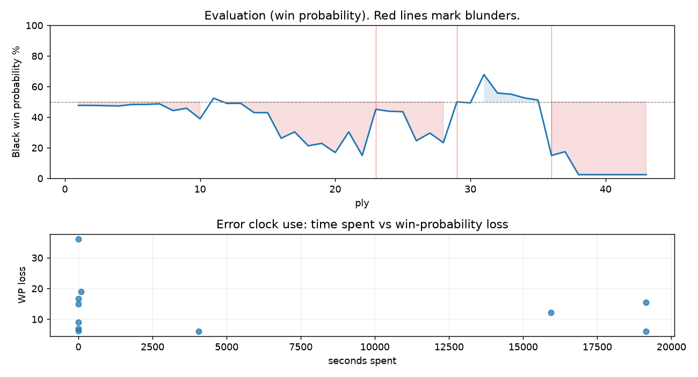

# (free, so lmk) Game analysis: Neuromorphic vs DanielKetterer

Date: 2026.09.17  |  Time control: daily (1/259200)  |  You played: black
Game ID: 320849aa-b240-11f1-9078-519bb301000b
Analysis: depth=24 multipv=3 findability=honest floor=6 stable_run=3 threads=1 hash_mb=256 deterministic=True engine_id=Stockfish_18 generated=2026-10-21T12:43:49Z
Game end time UTC: 2026-10-20T12:04:48+00:00
Game: https://www.chess.com/game/daily/1030376018

## Summary

- Lichess accuracy: you 66.4%, opponent 72.0%
- Opening: C45 Scotch Game (theory followed through ply 7)
- First deviation from theory: ply 8, You played 4... d5
- Your moves: 5 best, 2 excellent, 3 good, 5 inaccuracy, 5 mistake, 1 blunder

METRICS:

Best: The played move exactly matches Stockfish's top move

Excellent: A non-best move that loses 2 WP points or less.

Good: WP loss is over 2, but under 5 points; also used for losses under 20 when the position remains already decided.

Inaccuracy: WP loss is at least 5 but under 10 points.

Mistake: WP loss is at least 10 but under 20 points; also generally used when a forced mate is missed with under 10 points of WP loss.

Blunder: WP loss is 20 points or more, or a forced mate is missed with at least 10 points of WP loss.

See: https://support.chess.com/en/articles/8572705-how-are-moves-classified-what-is-a-blunder-or-brilliant-etc 

(Brillint, Great and Miss are rating subjective)
- Puzzles: 59 open, 0 solved

### Puzzle gate tally (this game)

Gates: category in ['brilliant_sacrifice', 'missed_tactic', 'allowed_tactic', 'endgame'], refute depth in [3, 8], best-vs-second WP gap >= 5. Refute bar per move: max(5, 0.6 x WP loss).

| outcome | errors |
|---|---|
| category:attention | 2 |
| category:positional | 1 |
| refute_too_deep | 1 |
| refute_too_shallow | 3 |
| wp_gap_too_small | 4 |

Four gates pass at once or nothing is generated, so a zero here is a product of four pass rates rather than a fault. Read the binding gate off this table before changing any threshold.

### Sacrifices in the engine's line

Real sacrifices are listed but never served as puzzles: compensation that never resolves back into material has no gradable answer.

| Move | Offered | Kind | Quiet | Line ends | Verdict |
|---|---|---|---|---|---|
| 5 | -2.0 (exchange) | sham | no | +1.0 pawns | opening_ply |
| 7 | -8.0 (piece) | real | yes | -1.0 pawns | real_sacrifice_not_gradable |
| 10 | -9.0 (piece) | real | yes | -1.0 pawns | real_sacrifice_not_gradable |
| 11 | -4.0 (piece) | real | yes | -1.0 pawns | real_sacrifice_not_gradable |
| 13 | -10.0 (piece) | real | yes | -1.0 pawns | real_sacrifice_not_gradable |
| 14 | -7.0 (piece) | real | yes | -4.0 pawns | real_sacrifice_not_gradable |
| 16 | -2.0 (exchange) | sham | no | +0.0 pawns | obvious |
| 18 | -9.0 (piece) | sham | no | +0.0 pawns | obvious |
| 19 | -5.0 (piece) | sham | yes | +0.0 pawns | eval_out_of_band |

## Biggest missed opportunity

You played 18...Re8. Stockfish preferred Bxc5, after which the main line runs 18...Bxc5 19. Qxc5 Qd8 20. Rd4 Qe8 21. h4. The evaluation crossed from equal to losing, which matters more than the raw number. Before committing to a quiet move here, the checklist is checks, captures, threats, in that order. The engine prefers this move from at or below depth 6, which is as shallow as this measurement resolves; it sits near the surface, a forcing move, the kind a checks-and-captures scan catches. Candidates considered by the engine: Bxc5 (-0.13), Bd6 (+0.00), Bd8 (+3.86).

## Critical positions

- Ply 23 (opponent), 12.Ra7: +4.72 -> +0.53 [evaluation crossed winning -> equal]
- Ply 25 (opponent), 13.Qxa7: +0.67 -> +0.70 [only-move situation]
- Ply 29 (opponent), 15.Bc5: +3.23 -> +0.00 [evaluation crossed winning -> equal]
- Ply 35 (opponent), 18.Rxe4: -0.28 -> -0.13 [only-move situation]
- Ply 36 (you), 18...Re8: -0.13 -> +4.71 [evaluation crossed equal -> losing]
- Ply 41 (opponent), 21.Qxc8+: M2 -> M1 [only-move situation]

## Your errors, move by move

| Move | Class | Category | WP loss | Refute depth | Seconds spent | Pre-error eval |
|---|---|---|---:|---|---:|---|
| 5...Bd7 | inaccuracy | allowed_tactic | 7% | 11 | 0 | balanced |
| 7...Bxb5 | inaccuracy | attention | 6% | 1 | 19145 | balanced |
| 8...c6 | mistake | missed_tactic | 17% | 6 | 0 | balanced |
| 9...a6 | inaccuracy | allowed_tactic | 9% | 1 | 0 | losing |
| 10...Be7 | inaccuracy | allowed_tactic | 6% | 2 | 4058 | losing |
| 11...axb5 | mistake | attention | 15% | 1 | 19148 | losing |
| 13...Qc7 | mistake | allowed_tactic | 19% | 6 | 88 | balanced |
| 14...Nf6 | inaccuracy | positional | 6% | 12 | 0 | losing |
| 16...dxe4 | mistake | missed_tactic | 12% | 5 | 15940 | winning |
| 18...Re8 | blunder | missed_tactic | 36% | 3 | 0 | balanced |
| 19...Rxe7 | mistake | allowed_tactic | 15% | 2 | 0 | losing |

### 5...Bd7 (inaccuracy, positional, wp loss 7%)

You played 5...Bd7. Stockfish preferred dxe4, after which the main line runs 5...dxe4 6. Nc3 Bd7 7. O-O f5 8. Bxc6. Why it went wrong: left pawn on d5 insufficiently defended; a favorable capture was available (dxe4). This was a judgment error rather than a missed tactic; compare the pawn structure and piece activity after both moves. The engine first prefers this move at depth 8 and holds it; findable, but it takes a deliberate look rather than a scan. Candidates considered by the engine: dxe4 (+0.45), Bd7 (+1.22), Ne7 (+1.23).

### 7...Bxb5 (inaccuracy, positional, wp loss 6%)

You played 7...Bxb5. Stockfish preferred c6, after which the main line runs 7...c6 8. Be2 dxe4 9. Nd2 Be6 10. Qxd8+. Why it went wrong: left bishop on b5 insufficiently defended; motif: creates threat on b5. This was a judgment error rather than a missed tactic; compare the pawn structure and piece activity after both moves. The engine prefers this move from at or below depth 6, which is as shallow as this measurement resolves; it sits near the surface, a quiet move, but one whose point shows at a glance. Candidates considered by the engine: c6 (+0.10), dxe4 (+0.34), Nf6 (+0.52).

### 8...c6 (mistake, tactical, wp loss 17%)

You played 8...c6. Stockfish preferred dxe4, after which the main line runs 8...dxe4 9. Qe5+ Qe7 10. Qd5 Rb8 11. Nc3. The evaluation crossed from equal to losing, which matters more than the raw number. Before committing to a quiet move here, the checklist is checks, captures, threats, in that order. The engine prefers this move from at or below depth 6, which is as shallow as this measurement resolves; it sits near the surface, a forcing move, the kind a checks-and-captures scan catches. Candidates considered by the engine: dxe4 (+0.77), Nf6 (+0.86), h5 (+1.75).

### 9...a6 (inaccuracy, positional, wp loss 9%)

You played 9...a6. Stockfish preferred dxe4, after which the main line runs 9...dxe4 10. Qxe4+ Qe7 11. bxc6 Qxe4+ 12. Nxe4. This was a judgment error rather than a missed tactic; compare the pawn structure and piece activity after both moves. The engine does not settle on this move until depth 17; reachable with real calculation, but not on a scan. Candidates considered by the engine: dxe4 (+2.25), Nf6 (+2.37), Bd6 (+2.71).

### 10...Be7 (inaccuracy, positional, wp loss 6%)

You played 10...Be7. Stockfish preferred Nf6, after which the main line runs 10...Nf6 11. exd5 Be7 12. bxc6 bxc6 13. Qc4. Why it went wrong: left pawn on g7 insufficiently defended. This was a judgment error rather than a missed tactic; compare the pawn structure and piece activity after both moves. The engine does not settle on this move until depth 11; reachable with real calculation, but not on a scan. Candidates considered by the engine: Nf6 (+3.30), Ne7 (+3.63), Bd6 (+3.77).

### 11...axb5 (mistake, tactical, wp loss 15%)

You played 11...axb5. Stockfish preferred Nf6, after which the main line runs 11...Nf6 12. bxc6 bxc6 13. exd5 cxd5 14. Qa4+. Why it went wrong: left pawn on g7 insufficiently defended. Before committing to a quiet move here, the checklist is checks, captures, threats, in that order. The engine prefers this move from at or below depth 6, which is as shallow as this measurement resolves; it sits near the surface, a forcing move, the kind a checks-and-captures scan catches. Candidates considered by the engine: Nf6 (+2.25), Bf6 (+3.04), Qc8 (+3.48).

### 13...Qc7 (mistake, positional, wp loss 19%)

You played 13...Qc7. Stockfish preferred Nf6, after which the main line runs 13...Nf6 14. e5 Ng4 15. Qxb7 O-O 16. Bb6. The evaluation crossed from equal to losing, which matters more than the raw number. This was a judgment error rather than a missed tactic; compare the pawn structure and piece activity after both moves. The engine does not settle on this move until depth 11; reachable with real calculation, but not on a scan. Candidates considered by the engine: Nf6 (+0.70), b4 (+0.92), d4 (+2.47).

### 14...Nf6 (inaccuracy, positional, wp loss 6%)

You played 14...Nf6. Stockfish preferred d4, after which the main line runs 14...d4 15. Bxd4 Nf6 16. Qa8+ Qd8 17. Qxb7. Why it went wrong: motif: fork; creates threat on e3, c3. This was a judgment error rather than a missed tactic; compare the pawn structure and piece activity after both moves. The engine first prefers this move at depth 9 and holds it; findable, but it takes a deliberate look rather than a scan. Candidates considered by the engine: d4 (+2.35), b4 (+2.83), Nf6 (+2.85).

### 16...dxe4 (mistake, tactical, wp loss 12%)

You played 16...dxe4. Stockfish preferred Bxc5, after which the main line runs 16...Bxc5 17. Qxc5 Re8 18. Qb4 Qd7 19. Kg2. The evaluation crossed from winning to equal, which matters more than the raw number. Before committing to a quiet move here, the checklist is checks, captures, threats, in that order. The engine prefers this move from at or below depth 6, which is as shallow as this measurement resolves; it sits near the surface, a forcing move, the kind a checks-and-captures scan catches. Candidates considered by the engine: Bxc5 (-2.03), b4 (-1.56), dxe4 (-0.66).

### 18...Re8 (blunder, tactical, wp loss 36%)

You played 18...Re8. Stockfish preferred Bxc5, after which the main line runs 18...Bxc5 19. Qxc5 Qd8 20. Rd4 Qe8 21. h4. The evaluation crossed from equal to losing, which matters more than the raw number. Before committing to a quiet move here, the checklist is checks, captures, threats, in that order. The engine prefers this move from at or below depth 6, which is as shallow as this measurement resolves; it sits near the surface, a forcing move, the kind a checks-and-captures scan catches. Candidates considered by the engine: Bxc5 (-0.13), Bd6 (+0.00), Bd8 (+3.86).

### 19...Rxe7 (mistake, positional, wp loss 15%)

You played 19...Rxe7. Stockfish preferred Qc8, after which the main line runs 19...Qc8 20. Qd4 h5 21. Bg5 f6 22. Bd2. This was a judgment error rather than a missed tactic; compare the pawn structure and piece activity after both moves. The engine never settles on this move within the analysis depth, so how findable it was is not measured here; weigh this one lightly. Candidates considered by the engine: Qc8 (+4.22), h6 (+4.29), Qd7 (+4.33).

## Full move table

| Ply | Move | Eval before | Eval after | Best | CP loss | WP loss | Class |
|-----|------|-------------|------------|------|---------|---------|-------|
| 1 | 1.e4 | +0.31 | +0.25 | e4 | 6 | 1% | best |
| 2 | 1...e5* | +0.25 | +0.25 | e5 | 0 | 0% | best |
| 3 | 2.Nf3 | +0.25 | +0.27 | Nf3 | 0 | 0% | best |
| 4 | 2...Nc6* | +0.27 | +0.29 | Nc6 | 2 | 0% | best |
| 5 | 3.d4 | +0.29 | +0.18 | Bc4 | 11 | 1% | excellent |
| 6 | 3...exd4* | +0.18 | +0.18 | exd4 | 0 | 0% | best |
| 7 | 4.Nxd4 | +0.18 | +0.14 | Nxd4 | 4 | 0% | best |
| 8 | 4...d5* | +0.14 | +0.62 | Nf6 | 48 | 4% | good |
| 9 | 5.Bb5 | +0.62 | +0.45 | Nxc6 | 17 | 2% | excellent |
| 10 | 5...Bd7* | +0.45 | +1.22 | dxe4 | 77 | 7% | inaccuracy |
| 11 | 6.a4 | +1.22 | -0.26 | exd5 | 148 | 13% | mistake |
| 12 | 6...Nxd4* | -0.26 | +0.11 | dxe4 | 37 | 3% | good |
| 13 | 7.Qxd4 | +0.11 | +0.10 | Qxd4 | 1 | 0% | best |
| 14 | 7...Bxb5* | +0.10 | +0.77 | c6 | 67 | 6% | inaccuracy |
| 15 | 8.axb5 | +0.77 | +0.77 | axb5 | 0 | 0% | best |
| 16 | 8...c6* | +0.77 | +2.81 | dxe4 | 204 | 17% | mistake |
| 17 | 9.Nc3 | +2.81 | +2.25 | Rxa7 | 56 | 4% | good |
| 18 | 9...a6* | +2.25 | +3.55 | dxe4 | 130 | 9% | inaccuracy |
| 19 | 10.O-O | +3.55 | +3.30 | bxc6 | 25 | 2% | excellent |
| 20 | 10...Be7* | +3.30 | +4.33 | Nf6 | 103 | 6% | inaccuracy |
| 21 | 11.Be3 | +4.33 | +2.25 | Qxg7 | 208 | 14% | mistake |
| 22 | 11...axb5* | +2.25 | +4.72 | Nf6 | 247 | 15% | mistake |
| 23 | 12.Ra7 | +4.72 | +0.53 | Rxa8 | 419 | 30% | blunder |
| 24 | 12...Rxa7* | +0.53 | +0.67 | Nf6 | 14 | 1% | excellent |
| 25 | 13.Qxa7 | +0.67 | +0.70 | Qxa7 | 0 | 0% | best |
| 26 | 13...Qc7* | +0.70 | +3.04 | Nf6 | 234 | 19% | mistake |
| 27 | 14.Re1 | +3.04 | +2.35 | exd5 | 69 | 5% | inaccuracy |
| 28 | 14...Nf6* | +2.35 | +3.23 | d4 | 88 | 6% | inaccuracy |
| 29 | 15.Bc5 | +3.23 | +0.00 | Bb6 | 323 | 27% | blunder |
| 30 | 15...O-O* | +0.00 | +0.07 | Bxc5 | 7 | 1% | excellent |
| 31 | 16.g3 | +0.07 | -2.03 | exd5 | 210 | 19% | mistake |
| 32 | 16...dxe4* | -2.03 | -0.63 | Bxc5 | 140 | 12% | mistake |
| 33 | 17.Nxe4 | -0.63 | -0.55 | Nxe4 | 0 | 0% | best |
| 34 | 17...Nxe4* | -0.55 | -0.28 | Nd5 | 27 | 2% | good |
| 35 | 18.Rxe4 | -0.28 | -0.13 | Rxe4 | 0 | 0% | best |
| 36 | 18...Re8* | -0.13 | +4.71 | Bxc5 | 484 | 36% | blunder |
| 37 | 19.Bxe7 | +4.71 | +4.22 | Rxe7 | 49 | 2% | good |
| 38 | 19...Rxe7* | +4.22 | M3 | Qc8 |  | 15% | mistake |
| 39 | 20.Qa8+ | M3 | M2 | Qa8+ |  | 0% | best |
| 40 | 20...Qc8* | M2 | M2 | Qc8 |  | 0% | best |
| 41 | 21.Qxc8+ | M2 | M1 | Qxc8+ |  | 0% | best |
| 42 | 21...Re8* | M1 | M1 | Re8 |  | 0% | best |
| 43 | 22.Qxe8# | M1 | M1 | Rxe8# |  | 0% | excellent |

Rows marked * are your moves. WP loss is win-probability loss; it is the primary signal, CP loss is shown for reference.

## Patterns in this game

- Error categories: 5 allowed_tactic, 2 attention, 3 missed_tactic, 1 positional.
- Attention errors per 100 moves: 9.5.
- Pre-error eval buckets: 1 winning, 5 balanced, 5 losing.
- Opening: 5 error(s) (avg wp loss 9%).
- Middlegame: 6 error(s) (avg wp loss 17%).
- 1 of your errors came with under a minute on the clock.
