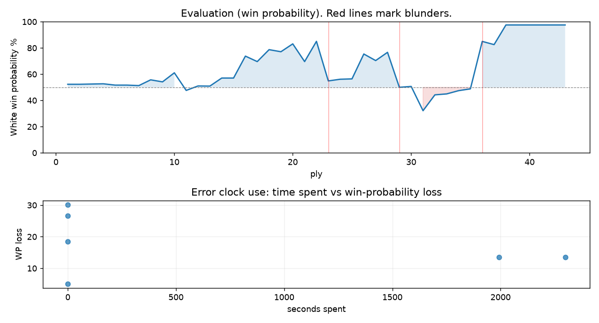

# (free, so lmk) Game analysis: Neuromorphic vs DanielKetterer

Date: 2026.09.17  |  Time control: daily (1/259200)  |  You played: white
Game ID: 320849aa-b240-11f1-9078-519bb301000b
Analysis: depth=24 multipv=3 findability=honest floor=6 stable_run=3 threads=1 hash_mb=256 deterministic=True engine_id=Stockfish_18 generated=2026-10-21T12:43:49Z
Game end time UTC: 2026-10-20T12:04:48+00:00
Game: https://www.chess.com/game/daily/1030376018

## Summary

- Lichess accuracy: you 72.0%, opponent 66.4%
- Opening: C45 Scotch Game (theory followed through ply 7)
- First deviation from theory: ply 8, Opponent played 4... d5
- Your moves: 10 best, 4 excellent, 2 good, 1 inaccuracy, 3 mistake, 2 blunder

METRICS:

Best: The played move exactly matches Stockfish's top move

Excellent: A non-best move that loses 2 WP points or less.

Good: WP loss is over 2, but under 5 points; also used for losses under 20 when the position remains already decided.

Inaccuracy: WP loss is at least 5 but under 10 points.

Mistake: WP loss is at least 10 but under 20 points; also generally used when a forced mate is missed with under 10 points of WP loss.

Blunder: WP loss is 20 points or more, or a forced mate is missed with at least 10 points of WP loss.

See: https://support.chess.com/en/articles/8572705-how-are-moves-classified-what-is-a-blunder-or-brilliant-etc 

(Brillint, Great and Miss are rating subjective)
- Puzzles: 59 open, 0 solved

### Puzzle gate tally (this game)

Gates: category in ['brilliant_sacrifice', 'missed_tactic', 'allowed_tactic', 'endgame'], refute depth in [3, 8], best-vs-second WP gap >= 5. Refute bar per move: max(5, 0.6 x WP loss).

| outcome | errors |
|---|---|
| category:attention | 3 |
| refute_too_deep | 1 |
| refute_too_shallow | 1 |
| wp_gap_too_small | 1 |

Four gates pass at once or nothing is generated, so a zero here is a product of four pass rates rather than a fault. Read the binding gate off this table before changing any threshold.

### Sacrifices in the engine's line

Real sacrifices are listed but never served as puzzles: compensation that never resolves back into material has no gradable answer.

| Move | Offered | Kind | Quiet | Line ends | Verdict |
|---|---|---|---|---|---|
| 6 | -2.0 (exchange) | sham | no | +1.0 pawns | desperado |
| 15 | -2.0 (exchange) | sham | yes | +2.0 pawns | obvious |
| 16 | -2.0 (exchange) | sham | no | +1.0 pawns | obvious |

## Biggest missed opportunity

You played 12.Ra7. Stockfish preferred Rxa8, after which the main line runs 12. Rxa8 Qxa8 13. exd5 Kf8 14. d6 Bf6. The evaluation crossed from winning to equal, which matters more than the raw number. Why it went wrong: a favorable capture was available (Qxg7). Before committing to a quiet move here, the checklist is checks, captures, threats, in that order. The engine prefers this move from at or below depth 6, which is as shallow as this measurement resolves; it sits near the surface, a forcing move, the kind a checks-and-captures scan catches. Candidates considered by the engine: Rxa8 (+4.72), Qxg7 (+3.04), Qe5 (+2.57).

## Critical positions

- Ply 23 (you), 12.Ra7: +4.72 -> +0.53 [evaluation crossed winning -> equal]
- Ply 25 (you), 13.Qxa7: +0.67 -> +0.70 [only-move situation]
- Ply 29 (you), 15.Bc5: +3.23 -> +0.00 [evaluation crossed winning -> equal]
- Ply 35 (you), 18.Rxe4: -0.28 -> -0.13 [only-move situation]
- Ply 36 (opponent), 18...Re8: -0.13 -> +4.71 [evaluation crossed equal -> losing]
- Ply 41 (you), 21.Qxc8+: M2 -> M1 [only-move situation]

## Your errors, move by move

| Move | Class | Category | WP loss | Refute depth | Seconds spent | Pre-error eval |
|---|---|---|---:|---|---:|---|
| 6.a4 | mistake | attention | 13% | 1 | 1993 | balanced |
| 11.Be3 | mistake | missed_tactic | 14% | 1 | 2298 | winning |
| 12.Ra7 | blunder | missed_tactic | 30% | 10 | 0 | winning |
| 14.Re1 | inaccuracy | attention | 5% | 1 | 0 | winning |
| 15.Bc5 | blunder | allowed_tactic | 27% | 4 | 0 | winning |
| 16.g3 | mistake | attention | 19% | 1 | 0 | balanced |

### 6.a4 (mistake, tactical, wp loss 13%)

You played 6.a4. Stockfish preferred exd5, after which the main line runs 6. exd5 Nxd4 7. Bxd7+ Qxd7 8. Qxd4 Nf6. Why it went wrong: left pawn on e4 insufficiently defended; a favorable capture was available (exd5). Before committing to a quiet move here, the checklist is checks, captures, threats, in that order. The engine prefers this move from at or below depth 6, which is as shallow as this measurement resolves; it sits near the surface, a forcing move, the kind a checks-and-captures scan catches. Candidates considered by the engine: exd5 (+1.22), Bxc6 (+0.62), O-O (+0.52).

### 11.Be3 (mistake, tactical, wp loss 14%)

You played 11.Be3. Stockfish preferred Qxg7, after which the main line runs 11. Qxg7 Bf6 12. Qg3 Ne7 13. bxc6 bxc6. Why it went wrong: a favorable capture was available (Qxg7). Before committing to a quiet move here, the checklist is checks, captures, threats, in that order. The engine never settles on this move within the analysis depth, so how findable it was is not measured here; weigh this one lightly. Candidates considered by the engine: Qxg7 (+4.33), bxc6 (+4.28), exd5 (+3.38).

### 12.Ra7 (blunder, tactical, wp loss 30%)

You played 12.Ra7. Stockfish preferred Rxa8, after which the main line runs 12. Rxa8 Qxa8 13. exd5 Kf8 14. d6 Bf6. The evaluation crossed from winning to equal, which matters more than the raw number. Why it went wrong: a favorable capture was available (Qxg7). Before committing to a quiet move here, the checklist is checks, captures, threats, in that order. The engine prefers this move from at or below depth 6, which is as shallow as this measurement resolves; it sits near the surface, a forcing move, the kind a checks-and-captures scan catches. Candidates considered by the engine: Rxa8 (+4.72), Qxg7 (+3.04), Qe5 (+2.57).

### 14.Re1 (inaccuracy, positional, wp loss 5%)

You played 14.Re1. Stockfish preferred exd5, after which the main line runs 14. exd5 f5 15. Rd1 b4 16. dxc6 Qxc6. This was a judgment error rather than a missed tactic; compare the pawn structure and piece activity after both moves. The engine prefers this move from at or below depth 6, which is as shallow as this measurement resolves; it sits near the surface, a quiet move, but one whose point shows at a glance. Candidates considered by the engine: exd5 (+3.04), Bb6 (+2.51), Qa8+ (+2.30).

### 15.Bc5 (blunder, positional, wp loss 27%)

You played 15.Bc5. Stockfish preferred Bb6, after which the main line runs 15. Bb6 Qc8 16. exd5 Kf8 17. Bc5 Bxc5. The evaluation crossed from winning to equal, which matters more than the raw number. Why it went wrong: motif: creates threat on c7. This was a judgment error rather than a missed tactic; compare the pawn structure and piece activity after both moves. The engine prefers this move from at or below depth 6, which is as shallow as this measurement resolves; it sits near the surface, a quiet move, but one whose point shows at a glance. Candidates considered by the engine: Bb6 (+3.23), exd5 (+2.62), Qa8+ (+0.87).

### 16.g3 (mistake, tactical, wp loss 19%)

You played 16.g3. Stockfish preferred exd5, after which the main line runs 16. exd5 Bxc5 17. Qxc5 Rd8 18. dxc6 bxc6. The evaluation crossed from equal to losing, which matters more than the raw number. Before committing to a quiet move here, the checklist is checks, captures, threats, in that order. The engine prefers this move from at or below depth 6, which is as shallow as this measurement resolves; it sits near the surface, a forcing move, the kind a checks-and-captures scan catches. Candidates considered by the engine: exd5 (+0.07), Bb6 (-1.23), Bxe7 (-1.45).

## Full move table

| Ply | Move | Eval before | Eval after | Best | CP loss | WP loss | Class |
|-----|------|-------------|------------|------|---------|---------|-------|
| 1 | 1.e4* | +0.31 | +0.25 | e4 | 6 | 1% | best |
| 2 | 1...e5 | +0.25 | +0.25 | e5 | 0 | 0% | best |
| 3 | 2.Nf3* | +0.25 | +0.27 | Nf3 | 0 | 0% | best |
| 4 | 2...Nc6 | +0.27 | +0.29 | Nc6 | 2 | 0% | best |
| 5 | 3.d4* | +0.29 | +0.18 | Bc4 | 11 | 1% | excellent |
| 6 | 3...exd4 | +0.18 | +0.18 | exd4 | 0 | 0% | best |
| 7 | 4.Nxd4* | +0.18 | +0.14 | Nxd4 | 4 | 0% | best |
| 8 | 4...d5 | +0.14 | +0.62 | Nf6 | 48 | 4% | good |
| 9 | 5.Bb5* | +0.62 | +0.45 | Nxc6 | 17 | 2% | excellent |
| 10 | 5...Bd7 | +0.45 | +1.22 | dxe4 | 77 | 7% | inaccuracy |
| 11 | 6.a4* | +1.22 | -0.26 | exd5 | 148 | 13% | mistake |
| 12 | 6...Nxd4 | -0.26 | +0.11 | dxe4 | 37 | 3% | good |
| 13 | 7.Qxd4* | +0.11 | +0.10 | Qxd4 | 1 | 0% | best |
| 14 | 7...Bxb5 | +0.10 | +0.77 | c6 | 67 | 6% | inaccuracy |
| 15 | 8.axb5* | +0.77 | +0.77 | axb5 | 0 | 0% | best |
| 16 | 8...c6 | +0.77 | +2.81 | dxe4 | 204 | 17% | mistake |
| 17 | 9.Nc3* | +2.81 | +2.25 | Rxa7 | 56 | 4% | good |
| 18 | 9...a6 | +2.25 | +3.55 | dxe4 | 130 | 9% | inaccuracy |
| 19 | 10.O-O* | +3.55 | +3.30 | bxc6 | 25 | 2% | excellent |
| 20 | 10...Be7 | +3.30 | +4.33 | Nf6 | 103 | 6% | inaccuracy |
| 21 | 11.Be3* | +4.33 | +2.25 | Qxg7 | 208 | 14% | mistake |
| 22 | 11...axb5 | +2.25 | +4.72 | Nf6 | 247 | 15% | mistake |
| 23 | 12.Ra7* | +4.72 | +0.53 | Rxa8 | 419 | 30% | blunder |
| 24 | 12...Rxa7 | +0.53 | +0.67 | Nf6 | 14 | 1% | excellent |
| 25 | 13.Qxa7* | +0.67 | +0.70 | Qxa7 | 0 | 0% | best |
| 26 | 13...Qc7 | +0.70 | +3.04 | Nf6 | 234 | 19% | mistake |
| 27 | 14.Re1* | +3.04 | +2.35 | exd5 | 69 | 5% | inaccuracy |
| 28 | 14...Nf6 | +2.35 | +3.23 | d4 | 88 | 6% | inaccuracy |
| 29 | 15.Bc5* | +3.23 | +0.00 | Bb6 | 323 | 27% | blunder |
| 30 | 15...O-O | +0.00 | +0.07 | Bxc5 | 7 | 1% | excellent |
| 31 | 16.g3* | +0.07 | -2.03 | exd5 | 210 | 19% | mistake |
| 32 | 16...dxe4 | -2.03 | -0.63 | Bxc5 | 140 | 12% | mistake |
| 33 | 17.Nxe4* | -0.63 | -0.55 | Nxe4 | 0 | 0% | best |
| 34 | 17...Nxe4 | -0.55 | -0.28 | Nd5 | 27 | 2% | good |
| 35 | 18.Rxe4* | -0.28 | -0.13 | Rxe4 | 0 | 0% | best |
| 36 | 18...Re8 | -0.13 | +4.71 | Bxc5 | 484 | 36% | blunder |
| 37 | 19.Bxe7* | +4.71 | +4.22 | Rxe7 | 49 | 2% | good |
| 38 | 19...Rxe7 | +4.22 | M3 | Qc8 |  | 15% | mistake |
| 39 | 20.Qa8+* | M3 | M2 | Qa8+ |  | 0% | best |
| 40 | 20...Qc8 | M2 | M2 | Qc8 |  | 0% | best |
| 41 | 21.Qxc8+* | M2 | M1 | Qxc8+ |  | 0% | best |
| 42 | 21...Re8 | M1 | M1 | Re8 |  | 0% | best |
| 43 | 22.Qxe8#* | M1 | M1 | Rxe8# |  | 0% | excellent |

Rows marked * are your moves. WP loss is win-probability loss; it is the primary signal, CP loss is shown for reference.

## Patterns in this game

- Error categories: 1 allowed_tactic, 3 attention, 2 missed_tactic.
- Attention errors per 100 moves: 13.6.
- Pre-error eval buckets: 4 winning, 2 balanced, 0 losing.
- Opening: 1 error(s) (avg wp loss 13%).
- Middlegame: 5 error(s) (avg wp loss 19%).
