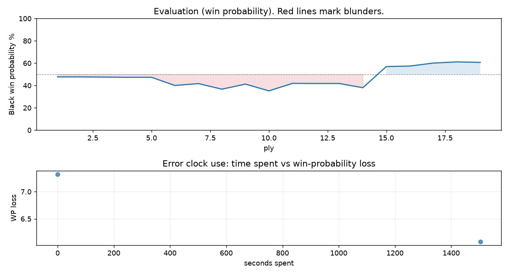

# (free, so lmk) Game analysis: DanielKetterer vs Neuromorphic

Date: 2026.10.20  |  Time control: daily (1/259200)  |  You played: black
Game ID: 7175d41a-ccdd-11f1-b221-e4059401000b
Analysis: depth=24 multipv=3 findability=honest floor=6 stable_run=3 threads=1 hash_mb=256 deterministic=True engine_id=Stockfish_18 generated=2026-11-04T15:01:59Z
Game end time UTC: 2026-11-03T15:26:43+00:00
Game: https://www.chess.com/game/daily/1047646506

## Summary

- Lichess accuracy: you 85.6%, opponent 74.2%
- Opening: C50 Italian Game (theory followed through ply 5)
- First deviation from theory: ply 6, You played 3... Nh6
- Your moves: 4 best, 1 excellent, 2 good, 2 inaccuracy, 0 mistake, 0 blunder

METRICS:

Best: The played move exactly matches Stockfish's top move

Excellent: A non-best move that loses 2 WP points or less.

Good: WP loss is over 2, but under 5 points; also used for losses under 20 when the position remains already decided.

Inaccuracy: WP loss is at least 5 but under 10 points.

Mistake: WP loss is at least 10 but under 20 points; also generally used when a forced mate is missed with under 10 points of WP loss.

Blunder: WP loss is 20 points or more, or a forced mate is missed with at least 10 points of WP loss.

See: https://support.chess.com/en/articles/8572705-how-are-moves-classified-what-is-a-blunder-or-brilliant-etc 

(Brillint, Great and Miss are rating subjective)
- Puzzles: 60 open, 0 solved

### Puzzle gate tally (this game)

Gates: category in ['brilliant_sacrifice', 'missed_tactic', 'allowed_tactic', 'endgame'], refute depth in [3, 8], best-vs-second WP gap >= 5. Refute bar per move: max(5, 0.6 x WP loss).

| outcome | errors |
|---|---|
| category:opening | 2 |

Four gates pass at once or nothing is generated, so a zero here is a product of four pass rates rather than a fault. Read the binding gate off this table before changing any threshold.

### Sacrifices in the engine's line

Real sacrifices are listed but never served as puzzles: compensation that never resolves back into material has no gradable answer.

| Move | Offered | Kind | Quiet | Line ends | Verdict |
|---|---|---|---|---|---|
| 5 | -6.0 (piece) | sham | no | +0.0 pawns | opening_ply |

## Critical positions

- Ply 19 (opponent), 10.Qd3: -1.23 -> -1.18 [only-move situation]

## Your errors, move by move

| Move | Class | Category | WP loss | Refute depth | Seconds spent | Pre-error eval |
|---|---|---|---:|---|---:|---|
| 3...Nh6 | inaccuracy | opening | 7% | 3 | 0 | balanced |
| 5...exd4 | inaccuracy | opening | 6% | >18 | 1503 | balanced |

### 3...Nh6 (inaccuracy, positional, wp loss 7%)

You played 3...Nh6. Stockfish preferred Nf6, after which the main line runs 3...Nf6 4. d3 Bc5 5. c3 d6 6. O-O. Why it went wrong: motif: creates threat on e4. This was a judgment error rather than a missed tactic; compare the pawn structure and piece activity after both moves. The engine prefers this move from at or below depth 6, which is as shallow as this measurement resolves; it sits near the surface, a quiet move, but one whose point shows at a glance. Candidates considered by the engine: Nf6 (+0.29), Bc5 (+0.32), Be7 (+0.49).

### 5...exd4 (inaccuracy, positional, wp loss 6%)

You played 5...exd4. Stockfish preferred Nxd4, after which the main line runs 5...Nxd4 6. Bxh6 gxh6 7. Nxe5 d6 8. Qh5. This was a judgment error rather than a missed tactic; compare the pawn structure and piece activity after both moves. The engine does not settle on this move until depth 18; reachable with real calculation, but not on a scan. Candidates considered by the engine: Nxd4 (+0.96), exd4 (+1.51), d5 (+2.31).

## Full move table

| Ply | Move | Eval before | Eval after | Best | CP loss | WP loss | Class |
|-----|------|-------------|------------|------|---------|---------|-------|
| 1 | 1.e4 | +0.31 | +0.25 | e4 | 6 | 1% | best |
| 2 | 1...e5* | +0.25 | +0.25 | e5 | 0 | 0% | best |
| 3 | 2.Nf3 | +0.25 | +0.27 | Nf3 | 0 | 0% | best |
| 4 | 2...Nc6* | +0.27 | +0.29 | Nc6 | 2 | 0% | best |
| 5 | 3.Bc4 | +0.29 | +0.29 | Bc4 | 0 | 0% | best |
| 6 | 3...Nh6* | +0.29 | +1.10 | Nf6 | 81 | 7% | inaccuracy |
| 7 | 4.O-O | +1.10 | +0.91 | Nc3 | 19 | 2% | excellent |
| 8 | 4...Bc5* | +0.91 | +1.48 | d6 | 57 | 5% | good |
| 9 | 5.d4 | +1.48 | +0.96 | c3 | 52 | 5% | good |
| 10 | 5...exd4* | +0.96 | +1.66 | Nxd4 | 70 | 6% | inaccuracy |
| 11 | 6.Bxh6 | +1.66 | +0.89 | c3 | 77 | 7% | inaccuracy |
| 12 | 6...gxh6* | +0.89 | +0.90 | gxh6 | 1 | 0% | best |
| 13 | 7.c3 | +0.90 | +0.90 | c3 | 0 | 0% | best |
| 14 | 7...dxc3* | +0.90 | +1.33 | d6 | 43 | 4% | good |
| 15 | 8.bxc3 | +1.33 | -0.76 | Nxc3 | 209 | 19% | mistake |
| 16 | 8...d6* | -0.76 | -0.81 | d6 | 0 | 0% | best |
| 17 | 9.Qd5 | -0.81 | -1.11 | Nbd2 | 30 | 3% | good |
| 18 | 9...Be6* | -1.11 | -1.23 | O-O | 0 | 0% | excellent |
| 19 | 10.Qd3 | -1.23 | -1.18 | Qd3 | 0 | 0% | best |

Rows marked * are your moves. WP loss is win-probability loss; it is the primary signal, CP loss is shown for reference.

## Patterns in this game

- Error categories: 2 opening.
- Attention errors per 100 moves: 0.0.
- Pre-error eval buckets: 0 winning, 2 balanced, 0 losing.
- Opening: 2 error(s) (avg wp loss 7%).
